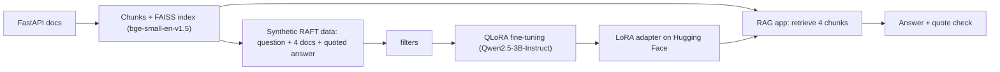
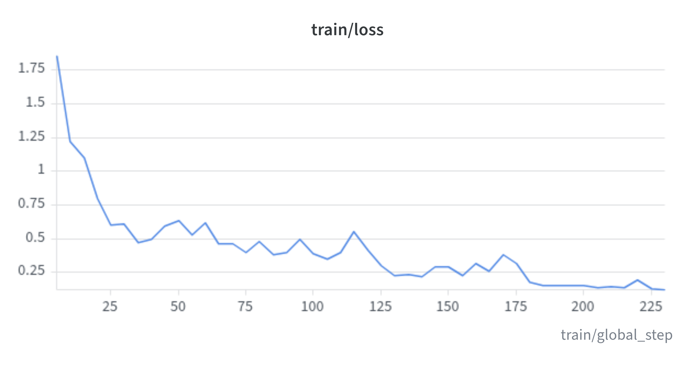
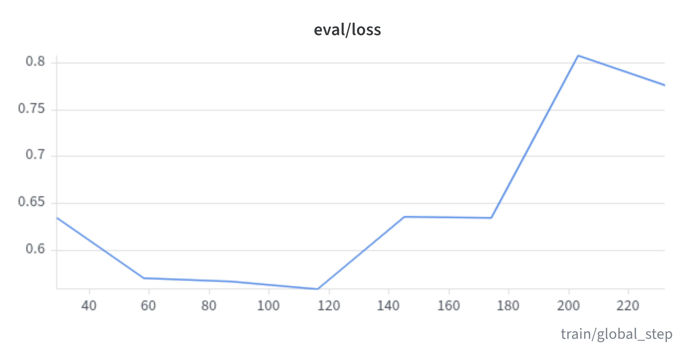

# FastAPI RAFT: fine-tuning a small LLM to answer from retrieved docs

A portfolio project that combines **RAG** and **fine-tuning**. I built a retrieval index over the FastAPI documentation, generated a synthetic **RAFT** (Retrieval-Augmented Fine-Tuning) dataset from it, and fine-tuned a 3B model with QLoRA so that it answers from retrieved documents, quotes its evidence, and ignores distractor documents.

- **Model (LoRA adapter):** https://huggingface.co/oualid2003/fastAPI-docs-lora
- **Training run (Weights & Biases):** https://wandb.ai/laiboualid2003-none/fastapi_tune-v2/runs/7rwzlo9n

## Summary

- Base model: `Qwen/Qwen2.5-3B-Instruct`, fine-tuned with QLoRA on a free Kaggle T4 GPU.
- Dataset: 264 synthetic examples (235 train, 26 validation), generated from the FastAPI docs with an LLM and filtered by script.
- The fine-tuned model reliably produces the trained answer format: short reasoning with verbatim quotes, then a final answer.
- A quote check in the app verifies that every quote really appears in the retrieved documents.
- Result: on 5 test questions the model answered well when the docs contained the answer, but it **invented quotes** when they did not. See [Results](#results).

## Pipeline



## RAFT

In RAFT, each training example is a question plus a mix of documents: one **oracle** document that contains the answer, and several **distractors** that do not. The target answer is a chain-of-thought that quotes the oracle and then concludes. In a fraction of examples the oracle is left out of the context, which pushes the model to learn the domain instead of only copying from the context.

Example format used here:

```
<DOC> ...chunk... </DOC>   (x4, shuffled)

Question: ...

Reasoning: ##begin_quote##exact sentence from a document##end_quote## one sentence linking it to the question.
<ANSWER>: final answer
```

## Dataset

Generated from chunks stored in the FAISS index (embeddings: `BAAI/bge-small-en-v1.5`):

1. Pick a chunk as the **oracle**.
2. An LLM (gpt-oss-120b through Groq's free API) writes 3 questions answerable only from that chunk.
3. The LLM writes a reasoning answer with verbatim quotes (`##begin_quote##...##end_quote##`).
4. **Distractors** are the chunks most similar to the oracle (hard negatives). Each example shows 4 documents; with probability 0.8 the oracle is one of them.

Automatic filters (a candidate is dropped if it fails any of them):

| Filter | Purpose |
|---|---|
| Chunk filter (`{%`, `{{`, `:::`) | Remove HTML templates and mkdocs reference stubs |
| Question phrase filter | Drop questions that depend on the passage ("the passage", "described", "in the tutorial"...) |
| Marker validity | Every `##begin_quote##` must be well formed and matched |
| Exact-quote check | Every quote must be a verbatim substring of the oracle chunk |
| Reasoning check | Require a real sentence of reasoning outside the quotes |
| Leaked-prompt check | Drop answers that copy the instructions |
| `NOT_ANSWERABLE` check | Drop answers the generator itself marked as unsupported |
| Character cleanup | Normalize typographic characters (non-breaking hyphens, curly quotes) |

Final size: **235 training and 26 validation examples** (random split by example).

## Training

| Setting | Value |
|---|---|
| Base model | `Qwen/Qwen2.5-3B-Instruct` (4-bit NF4 quantization) |
| Method | QLoRA: LoRA rank 16, alpha 32, dropout 0.05, all linear layers |
| Loss | Answer tokens only (documents and question are masked) |
| Learning rate | 1e-4, cosine schedule, 10 warmup steps, weight decay 0.01 |
| Batch | 1 per device x 4 gradient accumulation = 4 |
| Epochs | Up to 5, with early stopping (patience: 4 evaluations) |
| Evaluation | Every 29 steps (about twice per epoch); best checkpoint restored |
| Precision | fp16, gradient checkpointing, paged 8-bit AdamW |
| Hardware | Kaggle T4 GPU (one of two used) |

### Curves




Training loss fell from about 1.85 to about 0.12. Validation loss reached its minimum (about 0.56) at **step 116 (epoch 2)** and then rose to about 0.8, a clear sign of overfitting on a small dataset. Early stopping ended the run at step 232 (epoch 4). The published adapter is the **step-116 checkpoint** (lowest validation loss).

## Results

There is no formal benchmark. I ran 5 hand-picked questions through the full pipeline (FAISS retrieval of 4 chunks, then the fine-tuned model). "Quotes grounded" means every quoted passage appears verbatim in the retrieved chunks. All outputs are in [`test_results.md`](test_results.md).

| Question | Quotes grounded | Assessment |
|---|---|---|
| Run a function after the response is sent | True | Correct (`BackgroundTasks`) |
| Maximum length of a query parameter | True | Correct (`Query(max_length=50)`), but quotes too much |
| Read a cookie in a path operation | **False** | Invented quote; the retrieved chunks did not contain it |
| How do I use OAuth2 scopes? | True | Correct, but only explains the concept |
| Who won the 2018 football World Cup? (out of scope) | **False** | Answered from memory with an invented quote |

## Getting started (Kaggle)

This guide you to run project runs on a free Kaggle notebook.

### 1. Create the notebook
1. Go to [kaggle.com](https://www.kaggle.com), then **Create, New Notebook**.
2. Open **Settings** in the right sidebar and set:
   - **Accelerator:** GPU T4 x2

### 2. Install the dependencies (cell 1)
```python
!pip install -q -U bitsandbytes peft accelerate sentence-transformers langchain-community faiss-cpu
```

### 3. Get the code and the index (cell 2)
```python
!git clone https://github.com/Oualidlaib/fastapi-raft.git
%cd fastapi-raft
!ls faiss_index 
```

### 4. Load the model and ask a question (cells 3 and 4)
Paste the code from [Usage](#usage) into a cell and run it. The first run downloads the base model and adapter from Hugging Face. Then ask your own question:

```python
answer, grounded, full_text = ask("How do I declare a query parameter with a maximum length?")
print(answer if grounded else "No supported answer found in the retrieved documentation.")
```
## Usage

```python
import re, torch
from transformers import AutoTokenizer, AutoModelForCausalLM, BitsAndBytesConfig
from peft import PeftModel
from langchain_community.embeddings import HuggingFaceEmbeddings
from langchain_community.vectorstores import FAISS

BASE_MODEL = "Qwen/Qwen2.5-3B-Instruct"
ADAPTER = "oualid2003/fastAPI-docs-lora"

tokenizer = AutoTokenizer.from_pretrained(ADAPTER)
bnb = BitsAndBytesConfig(load_in_4bit=True, bnb_4bit_quant_type="nf4",
                         bnb_4bit_use_double_quant=True, bnb_4bit_compute_dtype=torch.float16)
base = AutoModelForCausalLM.from_pretrained(BASE_MODEL, quantization_config=bnb, device_map={"": 0})
model = PeftModel.from_pretrained(base, ADAPTER).eval()

embeddings = HuggingFaceEmbeddings(model_name="BAAI/bge-small-en-v1.5")
db = FAISS.load_local("faiss_index", embeddings, allow_dangerous_deserialization=True)


def ask(question, k=4):
    docs = db.similarity_search(question, k=k)
    context = "\n\n".join(f"<DOC>\n{d.page_content}\n</DOC>" for d in docs)   # same format as training
    prompt = tokenizer.apply_chat_template(
        [{"role": "user", "content": f"{context}\n\nQuestion: {question}"}],
        tokenize=False, add_generation_prompt=True)
    inputs = tokenizer(prompt, return_tensors="pt", add_special_tokens=False).to("cuda")
    with torch.no_grad():
        out = model.generate(**inputs, max_new_tokens=400, do_sample=False)
    text = tokenizer.decode(out[0][inputs["input_ids"].shape[1]:], skip_special_tokens=True)

    quotes = [q.strip() for q in re.findall(r"##begin_quote##(.*?)##end_quote##", text, re.DOTALL)]
    grounded = bool(quotes) and all(any(q in d.page_content for d in docs) for q in quotes)
    answer = text.split("<ANSWER>:")[-1].strip()
    return answer, grounded, text


answer, grounded, _ = ask("How do I run a function after the response is sent in FastAPI?")
print(answer if grounded else "No supported answer found in the retrieved documentation.")
```

### Example: success

> **Q:** How do I run a function after the response is sent in FastAPI?

> **A:** Use a `BackgroundTasks` parameter in the path operation function or dependency to schedule a function that runs after the response is sent.

The quote is a real sentence from the retrieved chunk, and the reasoning follows from it.

### Example: failure caught by the quote check

> **Q:** Who won the 2018 football World Cup?

> The model quoted "The 2018 FIFA World Cup was won by France." The sentence is not in any retrieved chunk, so the check returns `False` and the app does not show the answer.

## Repository contents

| File | Purpose |
|---|---|
| `build_index.ipynb` | Build the FAISS index from FastAPI markdown files (Kaggle)|
| `faiss_index/` | Prebuilt FAISS index of the FastAPI docs chunks (`index.faiss` + `index.pkl`), needed by the usage example |
| `build_dataset.py` | Generates the synthetic RAFT dataset from the FAISS index |
| `finetune_kaggle.ipynb` | QLoRA training notebook (Kaggle) |
| `raft_train.jsonl` | The training data |
| `test_results.md` | Full outputs of the 5 test questions |
| `images/` | Weights & Biases loss curves |

## Licenses and credits

- Base model: [Qwen2.5-3B-Instruct](https://huggingface.co/Qwen/Qwen2.5-3B-Instruct), released under the **Qwen Research License** (`qwen-research`).
- Source documentation: the [FastAPI](https://fastapi.tiangolo.com) docs.
- Synthetic questions and answers were generated with gpt-oss-120b through Groq.
